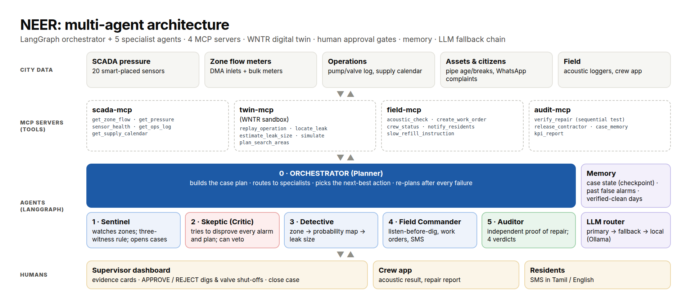

# NEER (நீர்): evidence-driven agentic leak investigation and repair verification

**HackSprint'26 · VCET Madurai · Problem SC-02 · Team Vector Zero**

> NEER investigates suspected water leaks using evidence and hydraulic reasoning, chooses the next safest action with human approval, and does not close the case until independent network measurements verify that the repair actually worked.

**Loop:** SUSPECT → QUESTION → INVESTIGATE → ACT → VERIFY → REPLAN. NEER targets the physical-loss (leakage) part of non-revenue water.

Six LangGraph agents own a leak case from the first signal to a proven repair. They use **19 tools on 4 MCP servers**, a **WNTR hydraulic digital twin**, an **evidence ledger**, and a human who approves every dig.



## The agents
| Agent | Job | Hard limit |
|---|---|---|
| **Sentinel** (deterministic data monitor) | Watches every zone's water bill and pressure. Three evidence dimensions: mass balance, hydraulic response, temporal persistence. 2–3-day slow-leak check | Cannot dispatch; no LLM |
| **Skeptic** (critic) | Tries to explain every alarm away: replays pump/valve actions and planned work in the twin, checks sensor health and short events. Asks to **wait for more data** when a signal is small. Reviews the plan. | Cannot approve its own plan |
| **Detective** | Flow picks the zone, pressure fingerprints pick the area; leak size ± uncertainty. Scores are *relative likelihoods*, not calibrated probabilities | Numbers only from tools |
| **Orchestrator** (planner) | Next-best action: value = (chance of finding + 0.3 × information gain) / cost. Repeats inconclusive surveys; re-plans after every acoustic "no", NOT FIXED or PARTLY FIXED; re-listens at a failed repair site; budget per search round, then escalates | Cannot skip a human gate |
| **Field Commander** | Acoustic check before any dig (yes / no / inconclusive), work orders, Tamil/English SMS, slow-refill instruction | **Safety validator:** acoustic "yes" + named approver + role supervisor/engineer + one open dig per case |
| **Auditor** | Independent, hour-by-hour sequential test. Measures the pre-repair loss **itself** (never uses the crew's report or the Detective's conclusion). FIXED / PARTLY FIXED / NOT FIXED / INCONCLUSIVE; releases or holds the contractor | FIXED needs 999:1 evidence and ≥ 3 h of data |

**Evidence ledger:** every case records each finding with its dimension, which way it points, reliability, source tool and time. **Protected memory:** "normal" is re-learned only from ≥ 2 Auditor-certified clean days, and every update is a new baseline version.

**Three self-correction loops:**
- **Tool:** validation, timeout, retry, circuit breaker, MCP → direct fallback.
- **Reasoning:** Skeptic gate and plan review; the LLM chain falls back to `rules`.
- **Reality:** acoustic "no", NOT FIXED and PARTLY FIXED each trigger a re-plan.

## Demo in 3 commands (Mac / Linux)
```bash
cd NEER
uv run python scripts/selfcheck.py     # 9 checks in ~10 s: agents, night watch, safety, database, API, dataset, maps, AI keys
./run_demo.sh                          # starts the REST API (:8000) and the dashboard (:8501)
```
Open **http://localhost:8501**. The first tab, **▶ Guided demo**, tells the whole story in six clicks: start the city → 02:00–04:00 scan (NEER opens a case by itself) → the agents investigate (map + team chat) → a viewer is refused / a supervisor approves → Auditor proves FIXED → ask the AI → the dataset and the live API. Every step shows a line to **say**. The script is in `docs/DEMO.md`.

## Run it
```bash
cd NEER
uv sync                                    # installs everything from uv.lock (Python 3.11)
cp .env.example .env                       # optional: add GROQ_API_KEY / GOOGLE_API_KEY for the LLM chain
uv run pytest -q                           # 89 test runs (~2-3 min; first run builds the leak library ~20 s)
uv run python -m neer.agents.runner --list                     # all scenarios
uv run python -m neer.agents.runner --scenario leak_20         # a whole case in the terminal
uv run python -m neer.agents.runner --scenario leak_20 --mode mcp   # same, through the 4 MCP servers
uv run streamlit run neer/app/dashboard.py                     # the Control Room (UI)
uv run uvicorn neer.api.server:app --port 8000                 # the REST API (2nd terminal) -> http://localhost:8000/docs
uv run python -m neer.eval.run_eval --seeds 41,42,43,44,45     # evaluation -> docs/EVAL.md
uv run python -m neer.eval.ablation 36                         # ablation study -> docs/ABLATION.md
uv run python scripts/engine_report.py 40                      # physics-engine benchmark (+ calibration check)
uv run python scripts/search_bench.py 120                      # larger search benchmark (headline numbers)
NEER_LLM_MIN_INTERVAL_S=6 uv run python -m neer.eval.llm_eval --seeds 41,42,43,44,45   # rules vs live AI -> docs/LLM_EVAL.md
uv run python scripts/build_dataset.py                          # rebuild the demo dataset (dataset/, CSV for Excel)
```
NEER runs with **no API keys**: the `rules` brain is the last link of the LLM chain (Groq → Gemini → Ollama → rules). With keys in `.env`, choose "LLM chain" in the dashboard or pass `--llm chain`. The AI owns the investigation (which hypothesis, what evidence is missing, where to search next); rules own physics, numbers and safety, and can veto it ([`docs/RULES_VS_AI.md`](docs/RULES_VS_AI.md)). A provider that fails on the network twice in a row is rested for 60 s, so bad Wi-Fi never slows the demo.

**Autonomous night watch (second tab):** no scenario to pick. A live simulated city runs night after night with hidden events (leaks of 12–40 L/s, a pump trip, planned work, fire-fighting, a frozen sensor, a valve closure, a wrong repair). Every night at **02:00–04:00** (minimum night flow) the Sentinel reads all raw SCADA data, and NEER **opens cases by itself**, questions them, locates the leak and runs listening surveys under a standing night policy. It asks a named supervisor or engineer only before a dig. Code: `neer/live.py`, `neer/app/nightwatch.py`. In a 24-night run (seed 7, digs approved), all 4 hidden leaks were proven FIXED, including the wrong repair, and no crew was sent for look-alikes.

**Database & REST API:** every agent step, human approval and work order is stored in a SQLite case database (`data/neer.db`, WAL mode, shared by the dashboard, the API and the 4 MCP server processes). A FastAPI backend (`neer/api/server.py`) exposes it and can run cases; see the "Database & API" tab and http://localhost:8000/docs. See `docs/REVIEW_GUIDE.md`.

**Control Room tabs:** Control Room (operations map on a Madurai basemap with an offline schematic fallback, live agent flowchart, decision cards, evidence ledger, Auditor meter) · Operations board (Kanban of all cases, impact strip, case-report PDF) · Twin sandbox (what-if on the digital twin) · Database & API (API status, run a case through the API, stored cases, read-only SQL).

Evaluations (`run_eval`, `llm_eval`, `ablation`) use their own chaos / world / trace files under `data/runs/`, so they can run while the dashboard is open.

Each MCP server can also run on its own, e.g. `uv run python -m neer.mcp_servers.scada_server` (stdio).

## Results (simulated, EPA Net3 network, harsh noise)
- **Agent evaluation on 5 fresh seeds (41–45), never used for tuning: passed 79/80 runs.**
  - 0 cases wrongly closed while a leak was still running.
  - 0 physical actions without a valid approver; 0 invalid tool calls.
  - 20/20 chaos runs recovered; 5/5 wrong repairs caught with the contractor held.
  - 0/35 look-alike events sent a crew.
  - Median 3 simulated days to a verified repair.
  - The 1 failure (a second leak not found) was escalated to a human.
  - Full table: [`docs/EVAL.md`](docs/EVAL.md).
- **Live AI vs rules** ([`docs/LLM_EVAL.md`](docs/LLM_EVAL.md)): both 79/80 with 0 wrong closures and 0 unapproved actions. The last chain run was starved by free-tier quota (13 of 337 decisions live), so it mostly measured the fallback path; re-run it with quota.
- **Ablation, do the agents matter?** ([`docs/ABLATION.md`](docs/ABLATION.md)). Same cases, five systems:

  | System | Crews sent for look-alikes | Leaks really fixed | Tickets closed while still leaking |
  |---|---|---|---|
  | Threshold alarm | 56% | 42% | 52% |
  | Leak model only | 56% | 56% | 35% |
  | + Skeptic | 6% | 56% | 35% |
  | + Orchestrator | 56% | 58% | 25% |
  | **Full NEER** | **6%** | **78%** | **0%** |
- **Physics engine benchmark** ([`docs/ENGINE_REPORT.txt`](docs/ENGINE_REPORT.txt)):
  - 0% false alarms on leak-free days; detected on day 1: 72% / 92% / 98% at 10 / 20 / 40 L/s.
  - Correct zone 96–98%. Leak found within 3 acoustic visits 58% / 72% / 75%, within 8 visits 86–94% (120 leaks per size); 0.09–0.18 wasted digs per leak.
  - Auditor never wrongly says FIXED on a still-leaking pipe (95–100%); median proof time 5 h (40 L/s) to about a day (10 L/s).
  - Calibration check: the top area's likelihood is conservative (e.g. 34% said vs 55% real at 20 L/s).

## Honest limits (what NEER does NOT claim)
- It is not the first agentic water system. Commercial platforms and recent research already detect leaks. NEER's difference is the closed loop: evidence-driven investigation, human-approved field action, independent proof of repair, and automatic re-planning.
- It does not claim that all non-revenue water is physical leakage. NRW also includes theft and billing losses; NEER targets leakage.
- This is a simulated city (the EPA Net3 benchmark), not field data, and has no live Madurai SCADA integration. The next steps are the BattLeDIM L-Town dataset, then historical utility data, then one DMA pilot. A real twin must first be calibrated on historical data.
- Area scores are relative likelihoods, not calibrated probabilities (see the calibration row in the engine report).
- Very small leaks (≤ 5–10 L/s) can take several days to show. NEER waits for more data instead of guessing.
- NEER promises an **area** (~1 km of pipe), not a GPS point; the acoustic check pinpoints within it.
- A rare persistent meter bias can open a false case. NEER searches, finds nothing, and escalates to a human, costing field visits but never closing a case wrongly.
- Intermittent (few-hours-a-day) supply needs a "supply-window mode". It is designed but not built.

## Repository map
```
neer/sim/          simulated city: Net3, 5 DMAs, 15 meters, noise, events, scenarios, fingerprint library
neer/engine/       physics & statistics: versioned baseline, 3 evidence dimensions, Skeptic checks, localisation, next-best-action planner, acoustic, independent Auditor
neer/tools/        19 tools + resilience layer + safety validator (RBAC) + chaos switches + shared world
neer/mcp_servers/  scada-mcp, twin-mcp, field-mcp, audit-mcp (FastMCP, stdio)
neer/agents/       LangGraph graph, 6 agents, LLM router (+ decision log, provider rest), MCP toolbox, CLI runner
neer/app/          Streamlit Control Room: ops map, flowchart, decision cards, ops board, case report, twin sandbox
neer/eval/         end-to-end evaluation, rules-vs-AI evaluation, ablation study
scripts/           engine_report, search_bench, build_dataset
neer/api/          REST API (FastAPI): health, scenarios, tools, run a case, stored cases, KPIs, trace
neer/store.py      case database (SQLite data/neer.db): cases, timeline, ledger, approvals, work orders
tests/             89 test runs (sim, engine, tools/MCP/safety, agents, AI split, dashboard)
dataset/           demo dataset (CSV): network, 37-day live city, 16 scenarios - see dataset/README.md
```
